# cart253

## Course repository for CART253 (Autumn 2026)

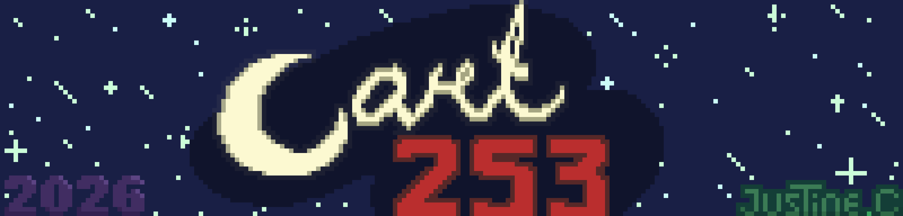

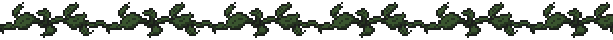

## :star: Welcome to ==Justine's== course repository! :star:

This website serves to present the prototyping work I will create in my class CART253, at Concordia University! I will be developing my coding skills using Javascript, making prototypes, and adding them here gradually, throughout the autumn semester.

### Useful links :link::bangbang::bookmark:

- [My reflective journal](journal.md)

### Prototypes :space_invader: :space_invader:

#### 3 Instructions Prototypes

##### The Last Little Pig - Midnight Snack

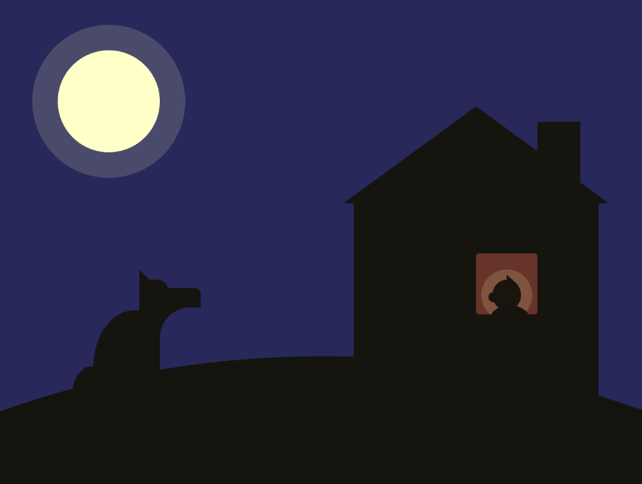

- [View online](https://justjust11-bit.github.io/cart253/topics/instructions/INSTRUCTIONS-PROTOYPES-HERE/midnight-snack/)

- [View code](https://github.com/justjust11-bit/cart253/tree/main/topics/instructions/INSTRUCTIONS-PROTOYPES-HERE/midnight-snack)

##### Movements

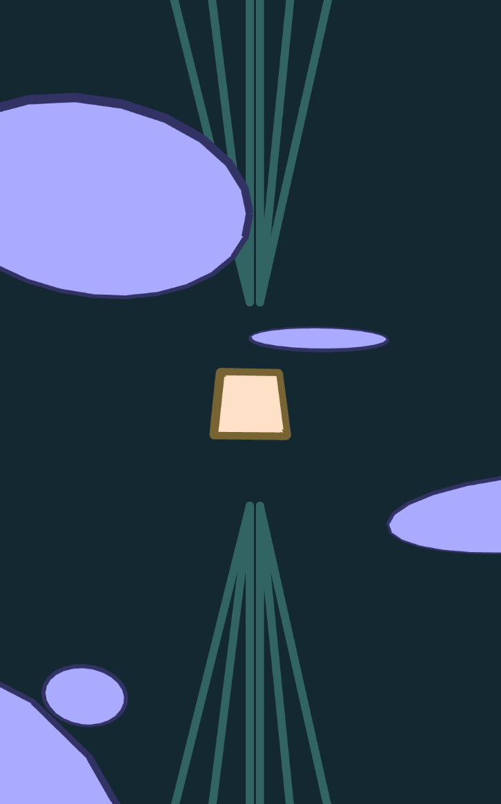

- [View online](https://justjust11-bit.github.io/cart253/topics/instructions/INSTRUCTIONS-PROTOYPES-HERE/movements/)

- [View code](https://github.com/justjust11-bit/cart253/tree/main/topics/instructions/INSTRUCTIONS-PROTOYPES-HERE/movements)

##### Strange Man

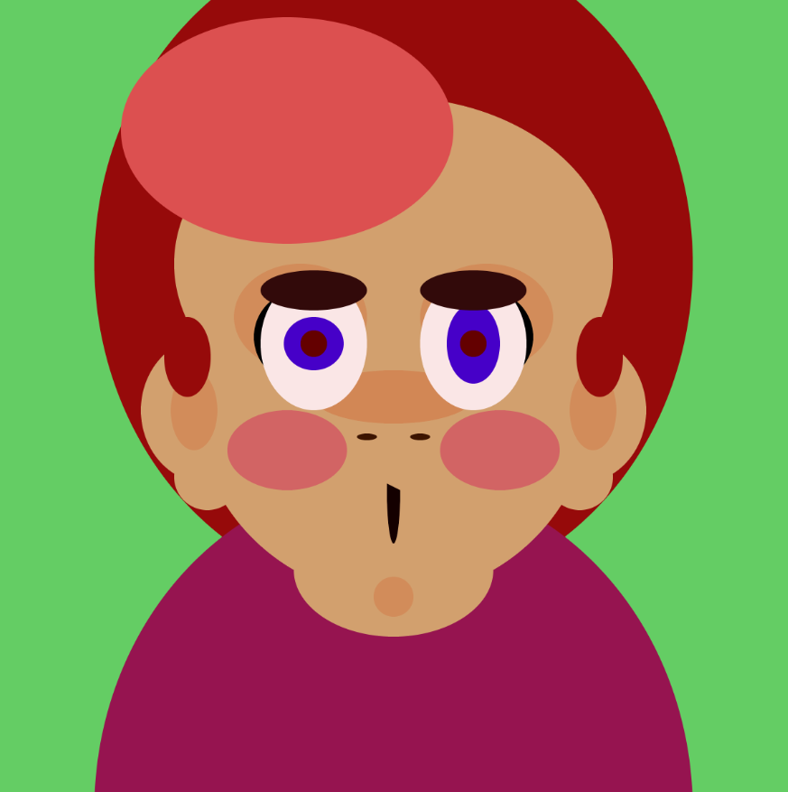

- [View online](https://justjust11-bit.github.io/cart253/topics/instructions/INSTRUCTIONS-PROTOYPES-HERE/strange-man/)
- [View code](https://github.com/justjust11-bit/cart253/tree/main/topics/instructions/INSTRUCTIONS-PROTOYPES-HERE/strange-man)

#### 3 Variables Prototypes

##### BAD IDEA

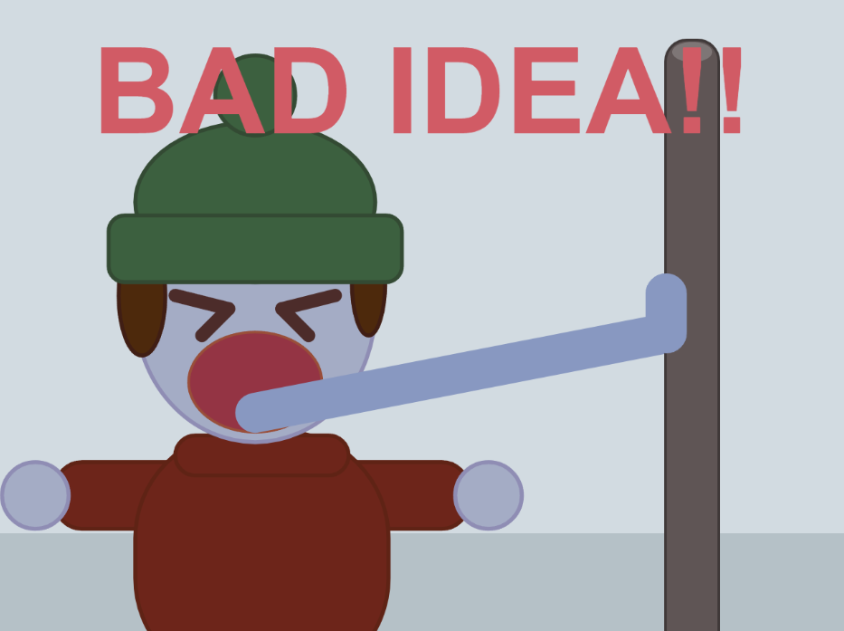

- [View online](https://justjust11-bit.github.io/cart253/topics/variables/PROTOYPES/BAD-IDEA/)

- [View code](https://github.com/justjust11-bit/cart253/tree/main/topics/variables/PROTOYPES/BAD-IDEA/)

##### Symmetrical Scratch Art

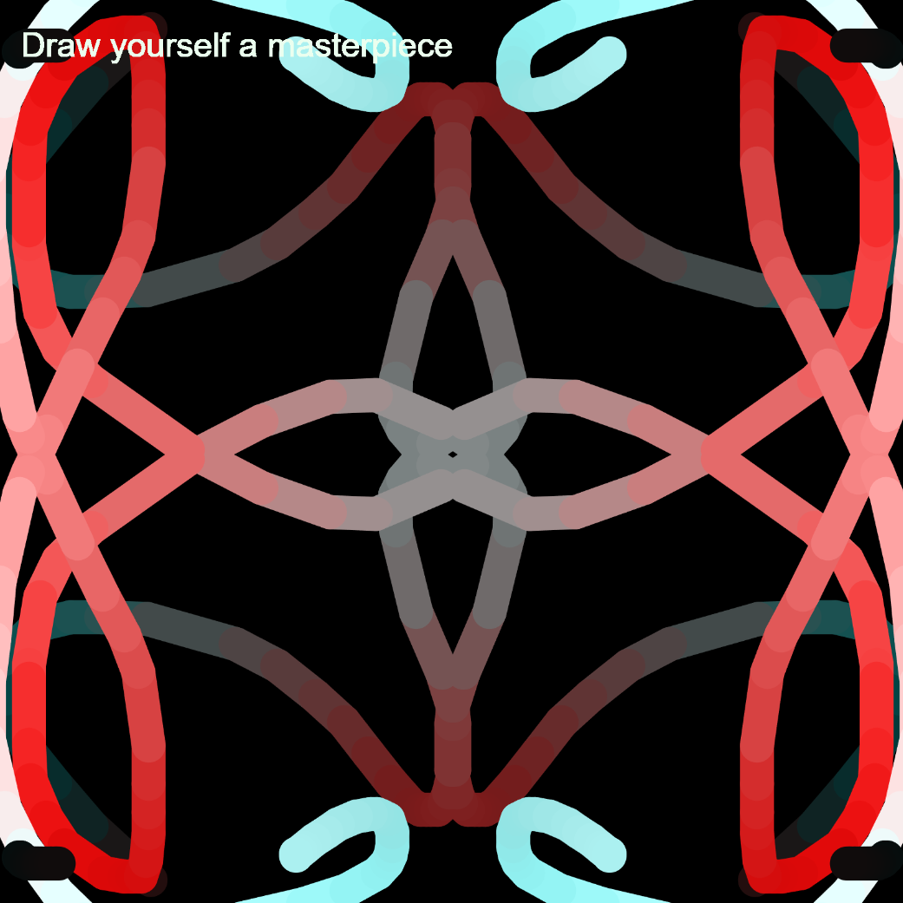

- [View online](https://justjust11-bit.github.io/cart253/topics/variables/PROTOYPES/Symmetrical-Scratch-Art/)

- [View code](https://github.com/justjust11-bit/cart253/tree/main/topics/variables/PROTOYPES/Symmetrical-Scratch-Art/)

##### Flooding City!

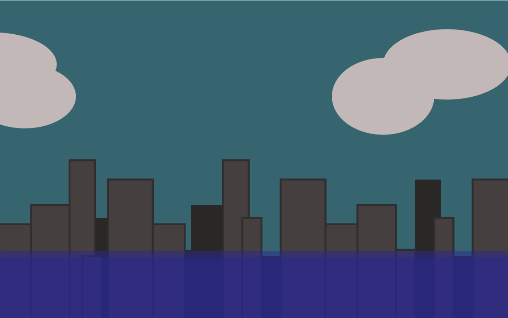

- [View online](https://justjust11-bit.github.io/cart253/topics/variables/PROTOYPES/Flooding-City!/)

- [View code](https://github.com/justjust11-bit/cart253/tree/main/topics/variables/PROTOYPES/Flooding-City!)

#### 3 Conditionals Prototypes

##### Ocean Domination

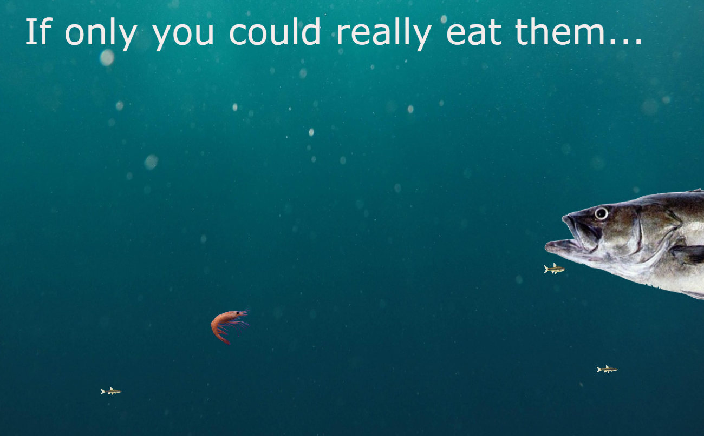

- [View online](https://justjust11-bit.github.io/cart253/topics/conditionals/PROTOTYPES/ocean-domination/)

- [View code](https://github.com/justjust11-bit/cart253/tree/main/topics/conditionals/PROTOTYPES/ocean-domination)

##### Fortune Cookie

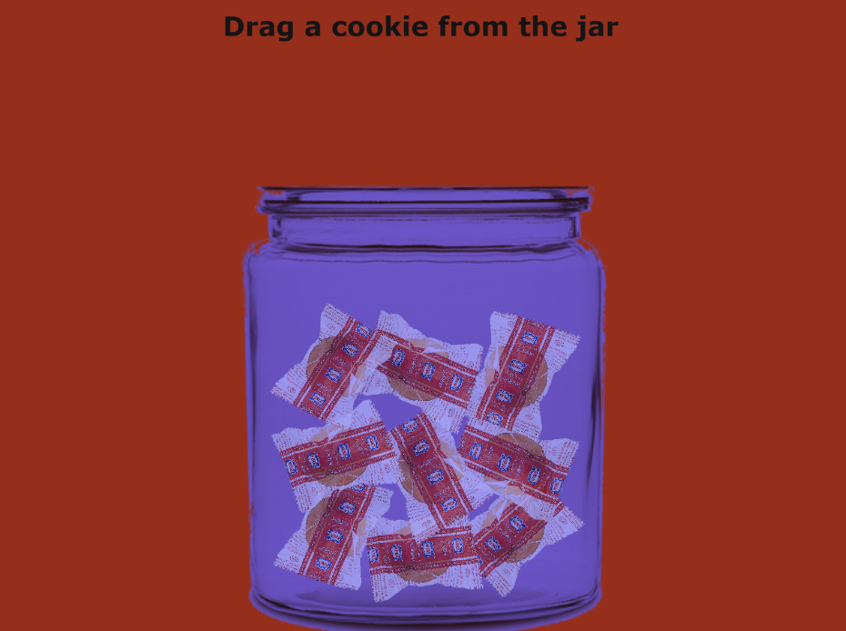

- [View online](https://justjust11-bit.github.io/cart253/topics/conditionals/PROTOTYPES/fortune-cookie/)

- [View code](https://github.com/justjust11-bit/cart253/tree/main/topics/conditionals/PROTOTYPES/fortune-cookie)

##### Three Shy Clowns

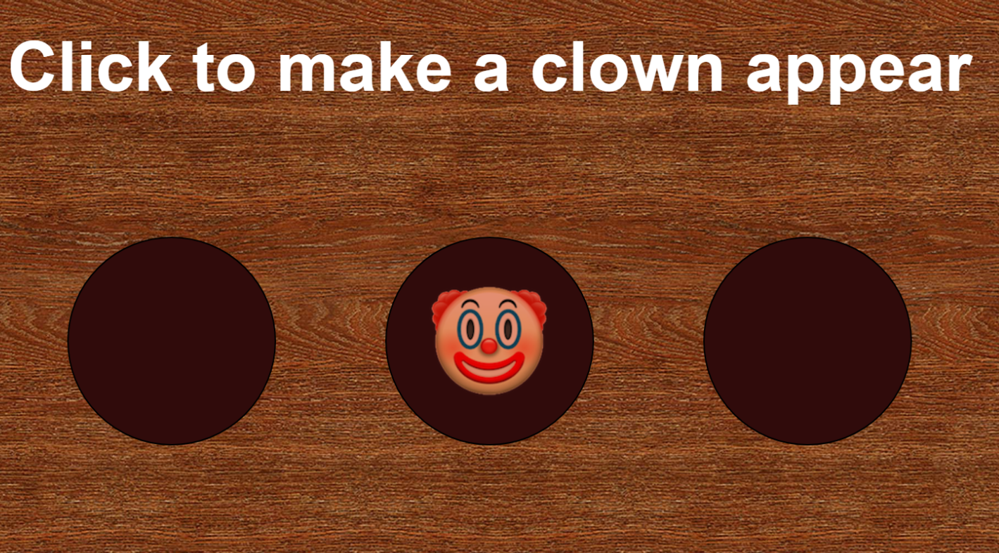

- [View online](https://justjust11-bit.github.io/cart253/topics/conditionals/PROTOTYPES/three-shy-clowns/)

- [View code](https://github.com/justjust11-bit/cart253/tree/main/topics/conditionals/PROTOTYPES/three-shy-clowns)

#### 3 Events Prototypes

##### Taiko rush!!

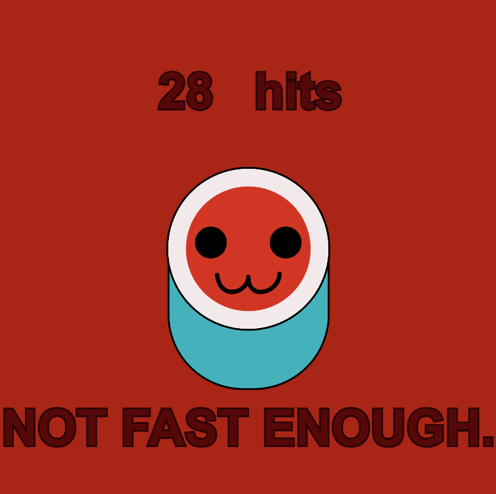

- [View online](https://justjust11-bit.github.io/cart253/topics/events/PROTOTYPES/taiko-rush/)

- [View code](https://github.com/justjust11-bit/cart253/tree/main/topics/events/PROTOTYPES/taiko-rush)

##### Make Your Own Scene

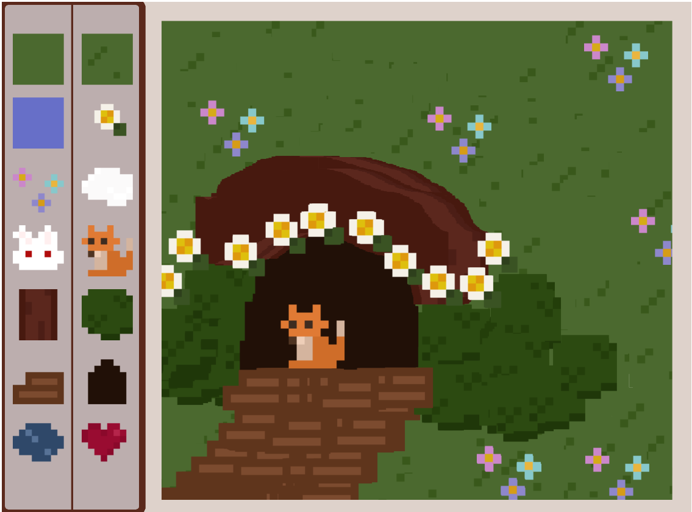

- [View online](https://justjust11-bit.github.io/cart253/topics/events/PROTOTYPES/make-your-own-scene)

- [View code](https://github.com/justjust11-bit/cart253/tree/main/topics/events/PROTOTYPES/make-your-own-scene)

##### One Note Rythm Game

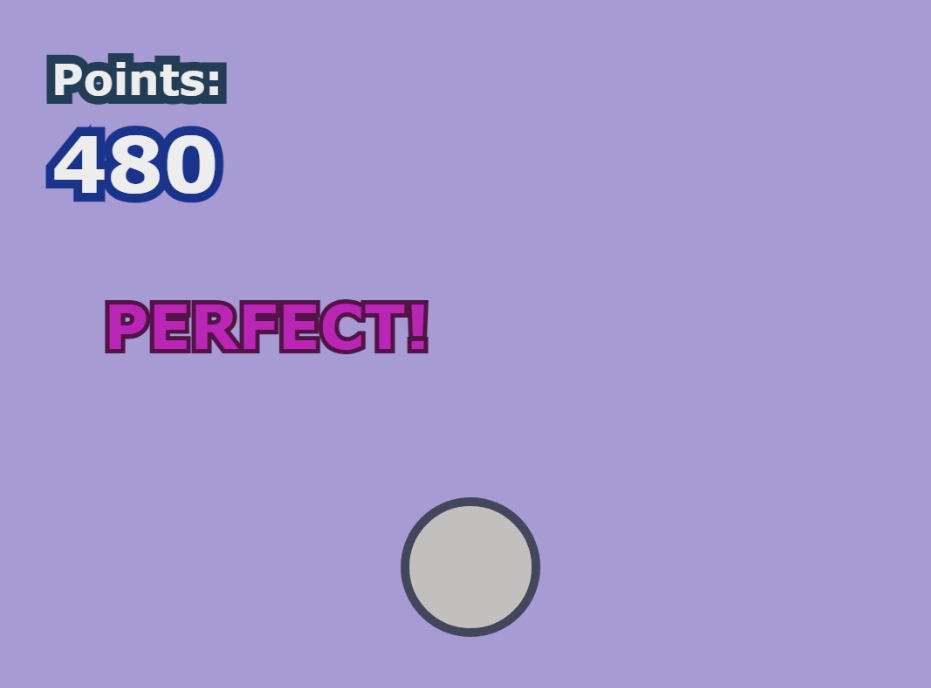

- [View online](https://justjust11-bit.github.io/cart253/topics/events/PROTOTYPES/one-note-rythm-game/)

- [View code](https://github.com/justjust11-bit/cart253/tree/main/topics/events/PROTOTYPES/one-note-rythm-game)

#### 3 Functions Prototypes

##### Shrinking Shooter

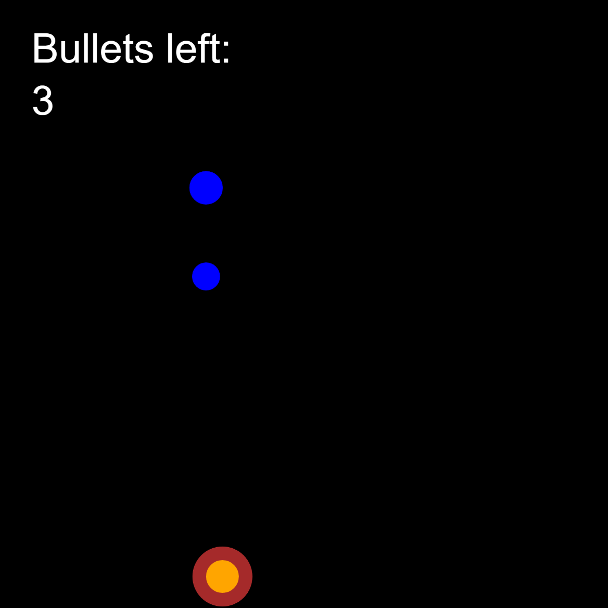

- [View online](https://justjust11-bit.github.io/cart253/topics/functions/PROTOTYPES/shrinking-shooter/)

- [View code](https://github.com/justjust11-bit/cart253/tree/main/topics/functions/PROTOTYPES/shrinking-shooter)

##### Ocean Domination Refactored

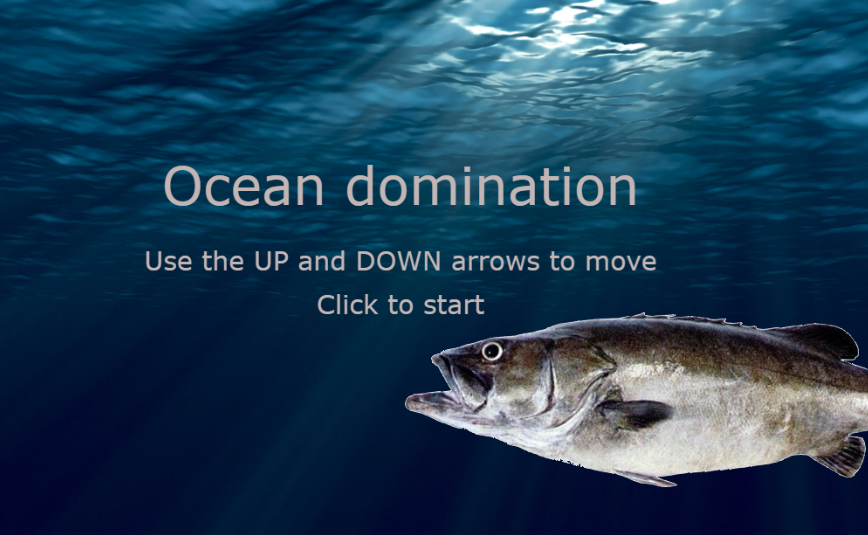

- [View online](https://justjust11-bit.github.io/cart253/topics/functions/PROTOTYPES/ocean-domination-refactored/)

- [View code](https://github.com/justjust11-bit/cart253/tree/main/topics/functions/PROTOTYPES/ocean-domination-refactored)

##### The Square Hole

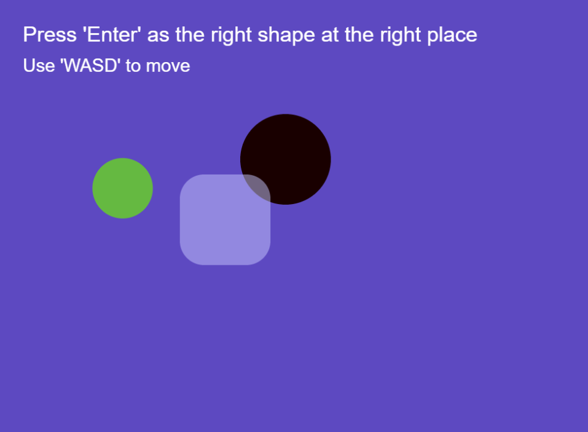

- [View online](https://justjust11-bit.github.io/cart253/topics/functions/PROTOTYPES/the-square-hole/)

- [View code](https://github.com/justjust11-bit/cart253/tree/main/topics/functions/PROTOTYPES/the-square-hole)
